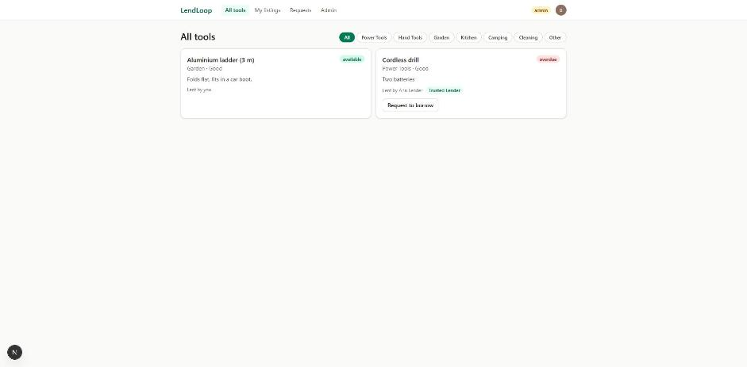
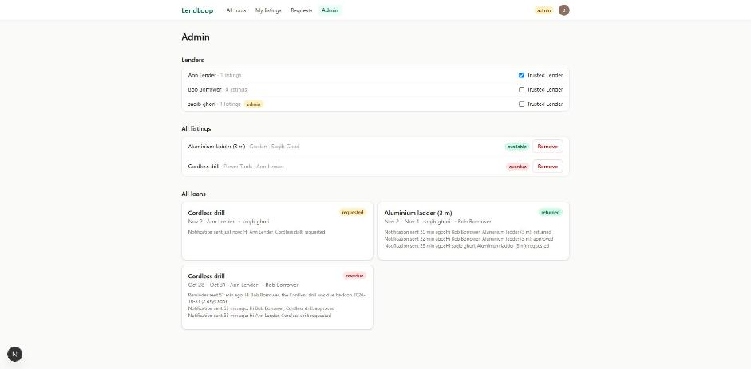
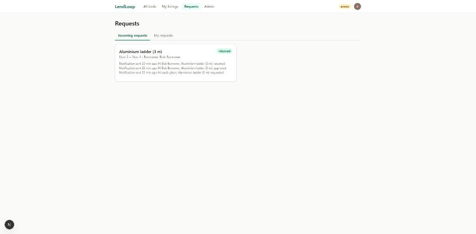

# LendLoop

A neighborhood tool-lending board. Neighbors list tools, request to borrow them for a date range, and lenders approve, decline and mark loans returned. n8n sends a notification on every status change and a daily reminder for overdue loans.

Stack: Next.js 15 (App Router, TypeScript) · Clerk (auth) · Convex (data and backend logic) · n8n (automation).







## Run it locally

Prerequisites: Node 20+, Docker (for n8n).

```bash
npm install
npx convex dev            # first run creates a deployment and writes CONVEX_* to .env.local
```

1. **Clerk.** Create an application at clerk.com, put `NEXT_PUBLIC_CLERK_PUBLISHABLE_KEY` and `CLERK_SECRET_KEY` in `.env.local` (see `.env.local.example`).
2. **Convex environment** (server-side, not in `.env.local`):
   ```bash
   npx convex env set CLERK_JWT_ISSUER_DOMAIN https://<your-app>.clerk.accounts.dev
   npx convex env set LENDLOOP_HMAC_SECRET $(node -e "console.log(require('crypto').randomBytes(32).toString('hex'))")
   npx convex env set N8N_WEBHOOK_URL http://127.0.0.1:5678/webhook/lendloop-loan-status
   npx convex env set ADMIN_USER_IDS user_xxx     # your Clerk user id, after you sign in once
   ```
3. **n8n.** Copy `.env.n8n.example` to `.env.n8n` and set the same `LENDLOOP_HMAC_SECRET`. Then `docker compose up`. The container imports the three workflows from `n8n/workflows/` on start; open http://localhost:5678, create the owner account, and make sure "loan status notification" and "daily overdue reminders" are active.
4. `npm run dev` and open http://localhost:3000.

**n8n without Docker** (how it was tested on Windows without WSL): install `n8n@1.123` with npm in its own folder, add `"overrides": { "@langchain/langgraph-checkpoint": "1.0.0" }` to that folder's `package.json` (the npm release otherwise resolves an incompatible version), then:
```bash
export N8N_BLOCK_ENV_ACCESS_IN_NODE=false NODE_FUNCTION_ALLOW_BUILTIN=crypto LENDLOOP_HMAC_SECRET=... CONVEX_SITE_URL=http://127.0.0.1:3211
npx n8n import:workflow --separate --input=path/to/lendloop/n8n/workflows
npx n8n start
```
Verified end to end against the real n8n: a forged webhook gets 401, a loan request produces the notification and its write-back on the loan, and running the overdue workflow twice writes one reminder (`duplicate: true` on the second run).

## Architecture

```
Browser ──Clerk session token──> Convex queries/mutations (all rules enforced here)
                                   │
                                   │ status change → outbox row → scheduled action
                                   ▼
                          n8n webhook (HMAC-verified) ──mock notification──> write-back
                                   ▲                                              │
         n8n schedule (daily) ──signed POST /n8n/overdue                         ▼
                                   └── per loan: reminder ──signed POST /n8n/log (idempotent)
```

- `convex/schema.ts` – users, tools, loans, `webhookEvents` (outbox), `automationLog` (write-backs).
- `convex/tools.ts`, `convex/loans.ts`, `convex/admin.ts` – every query and mutation checks the caller.
- `convex/lib/events.ts`, `convex/webhooks.ts` – outbox and delivery to n8n with retries.
- `convex/http.ts`, `convex/automation.ts`, `convex/lib/hmac.ts` – the signed endpoints n8n calls.
- `src/app/*` – public page, All tools, My listings, Requests (incoming and mine), Admin.
- `n8n/workflows/*.json` – exported workflows (no secrets inside).

## Roles and access control

Enforced in Convex functions, not only hidden in the UI:

| Action | Who |
|---|---|
| See available tools (name and category only) | anyone, signed out |
| List, edit, delete a tool | the owner; admins can remove any listing |
| Request to borrow | any signed-in user, not for their own tool, no overlap with an approved loan, max 30 days |
| Approve, decline, mark returned | the tool's owner only |
| Cancel a request | the borrower, while it is still pending |
| View all loans, mark "Trusted Lender" | admin |

Admins are configured on the server (`ADMIN_USER_IDS`, Clerk user ids). The client can never choose its own role. Convex verifies Clerk's session JWT against Clerk's JWKS (`convex/auth.config.ts`).

## Automation and security decisions

- **Signed in both directions.** Every request between Convex and n8n carries `X-LendLoop-Timestamp` and `X-LendLoop-Signature: sha256=HMAC(secret, "<timestamp>.<raw body>")`. The receiver recomputes it with a constant-time compare and rejects anything older than 5 minutes, so a captured request cannot be replayed. The overdue endpoint is a signed `POST` with an empty JSON body for the same reason.
- **Secrets** live only in Convex environment variables and n8n's environment (`.env.n8n`, git-ignored). The exported workflow JSON reads `$env.LENDLOOP_HMAC_SECRET` and contains no secret values.
- **Idempotent write-backs.** Every write from n8n has a key: `notify:<eventId>` for status notifications and `overdue:<loanId>:<date>` for reminders. Convex stores it with a unique lookup, so retries or a second run on the same day return `duplicate: true` instead of creating another record. A failed attempt can later be upgraded to "sent".
- **Reliable delivery, never silent.** Status changes are written to an outbox in the same transaction as the change, then delivered by a scheduled action with retries (2, 4, 8, 16 s). After 5 failures the event is marked failed and the failure appears in the loan's activity. In n8n, HTTP nodes retry 3 times, and both workflows use the error workflow, which logs the failure (it stays in the Executions list) and can alert a Slack or Discord webhook.
- **Data minimization.** Convex stores no email or phone, only a display name. Payloads to n8n contain the recipient's id and display name, the tool name, the dates and the status: nothing else. The public page shows tool names and categories only, never owners.
- **Activity on each loan.** Write-backs show on the loan card, e.g. "Reminder sent 2 days ago".

## Testing without n8n

`scripts/fake-n8n.mjs` listens on :5678 and verifies signatures exactly like the n8n Code node; `scripts/run-overdue.mjs` runs the overdue workflow's steps, including a forged signature (expects 401) and a retried write-back (expects `duplicate: true`). `convex/devtools.ts` backdates a loan when `ENABLE_DEV_TOOLS=1`.

## What I would change for production

- Real notification channel (email via Resend/Postmark) with users' contact details stored at the channel provider, not in Convex.
- Rotate the HMAC secret with two active keys during rotation; move secrets to a secret manager.
- Rate limits on mutations, an audit log of admin actions, and pagination for large boards.
- Timezone-aware due dates per neighborhood instead of UTC days.
- Monitoring: alert when the outbox has failed events or the daily workflow did not run.
- Hosted n8n with queue mode and a Postgres database instead of the default SQLite.
